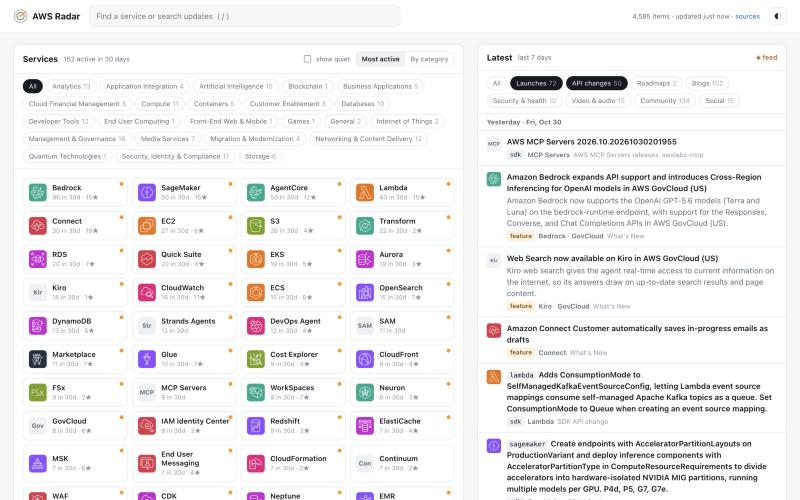

# AWS Radar

[](https://github.com/pfeilbr/aws-radar/actions/workflows/update.yml)
[](https://github.com/pfeilbr/aws-radar/actions/workflows/ci.yml)
[](https://pfeilbr.github.io/aws-radar/)

A self-updating, expert-level digest of everything new in AWS, browsable by service.

**→ [pfeilbr.github.io/aws-radar](https://pfeilbr.github.io/aws-radar/)**

AWS ships dozens of changes a day across hundreds of services, spread over What's New posts,
~45 blogs, SDK changelogs, public roadmaps, security bulletins, videos, Reddit, Hacker News
and social posts. AWS Radar pulls all of it every 6 hours, maps each item to the service(s)
it is about, and publishes a static site: pick a service by its official AWS icon and see
what changed, newest first, one line each.

It is written for people who already know AWS: no "what is S3" intros, no marketing copy,
just the change, the date, the source link and a tag such as `GA`, `preview`, `region`,
`pricing`, `deprecation`, `shipped` or `coming-soon`.



## What you get

- **Service pages** with a 26-week activity chart, filters by kind (launches, API changes,
  roadmaps, blogs, security & health, video, community, social) and tag, and shareable URLs
  (`#/s/eks?k=roadmap`). Posts that only tag a service in passing are hidden unless asked for.
- **Watchlist**: star services; they lead the home page and can filter the Latest stream.
- **Search** across the full history (`/` to focus, Enter to search).
- **Atom feeds** for every service (`feeds/s/<id>.xml`), plus `feeds/launches.xml` and
  `feeds/all.xml`.
- **Weekly digests** in [`data/weekly/`](data/weekly/): launches by service, API changes,
  roadmap items shipped, most-discussed stories.
- **Per-service Markdown** in [`data/services/`](data/services/), readable right on GitHub.
- **Source health** at [`#/sources`](https://pfeilbr.github.io/aws-radar/#/sources); a source
  failing for over a day opens a GitHub issue that closes itself on recovery.
- **Region chips** on launches (`af-south-1, ca-central-1`) parsed from the post.

## How it works

```
 sources (config/sources.yaml)
   │  RSS/Atom, AWS JSON APIs, GitHub, Reddit, Hacker News, Bluesky, X
   ▼
 collect   ──► data/raw/<source>/<YYYY-MM>.jsonl     append-only, one JSON item per line
   ▼
 classify  ──► services (primary / mentioned), tags, regions     rules, no LLM
   ▼
 build     ──► site/data, site/feeds                 static site data + Atom feeds
           ──► data/services, data/weekly, data/changes, data/reports   Markdown
   ▼
 git commit + push                                   the diff is the changelog
```

Design rules:

- **No LLM tokens in the pipeline.** Everything is deterministic Python: feeds, APIs, regex
  and keyword rules. Runs are repeatable, cheap, and free on GitHub Actions.
- **Git is the database.** Collected items are committed as JSONL and never rewritten.
  Everything else is regenerated from them, so rule changes apply to history.
- **Static output.** Plain HTML, CSS and vanilla JS reading pre-built data. Works on GitHub
  Pages and straight from disk (`site/index.html`).
- **Official icons** from the [AWS Architecture Icons](https://aws.amazon.com/architecture/icons/)
  package, mapped to a 295-service catalog.

## Sources

24 configured, 23 enabled. Full list with notes in [`config/sources.yaml`](config/sources.yaml)
and [`docs/sources.md`](docs/sources.md).

| Group | Sources | Auth |
| --- | --- | --- |
| AWS official | What's New, all ~45 AWS blogs (one JSON API), News Blog, Security Bulletins, Service Health | none |
| AWS code | botocore changelog (every API change), CDK, SAM CLI and AWS MCP Servers releases | none |
| AWS roadmaps | Containers roadmap (Shipped, Coming Soon), CloudFormation coverage roadmap (shipped) | none |
| AWS media | AWS Podcast, three AWS YouTube channels | none |
| Community | r/aws + r/aws_cdk + r/serverless + r/amazonbedrock, Hacker News, Last Week in AWS, Community Builders | none |
| Social | 15 AWS staff and Hero accounts on Bluesky; X follows (disabled until a token is added) | Bluesky: none. X: paid API |

## Repository layout

```
aws-radar/
├── config/
│   ├── sources.yaml            every source: type, URL, cadence, auth, notes
│   ├── service_overrides.yaml  hand-curated ids, aliases, keywords (edit this)
│   ├── services.yaml           service catalog (generated from the icon package + overrides)
│   └── vocab/                  What's New slugs, botocore service names, AWS regions
├── radar/                      the pipeline (Python package)
│   ├── collectors/             rss, aws_blog_api, hn, bluesky, botocore, github_issues, x
│   ├── catalog.py              service catalog + name matcher
│   ├── classify.py             item → services, tags, regions
│   ├── collect.py              runs due collectors, appends to data/raw
│   ├── build.py                site data, feeds, Markdown digests, reports
│   └── http.py / store.py / text.py
├── scripts/
│   ├── update.py               collect → build → commit (the scheduled job)
│   ├── validate_sources.py     hit every source, report health
│   ├── build_catalog.py        download AWS icons, regenerate services.yaml
│   └── health_issues.py        open/close GitHub issues for failing sources
├── data/
│   ├── raw/                    collected items, append-only, committed
│   ├── state/                  cursors, ETags, last success/error per source
│   └── services/ weekly/ changes/ reports/   generated Markdown
├── site/                       index.html, app.js, app.css, assets/icons/
│                               (data/ and feeds/ are generated, not committed)
├── samples/                    runnable prototypes: samples/<service>/<language>/<name>/
├── tests/                      pytest suite with fixtures
└── .github/workflows/          update (6h), pages, ci; dependabot
```

## Running it

Requires Python 3.12+ and [uv](https://docs.astral.sh/uv/).

```bash
uv run scripts/update.py                # collect due sources, rebuild everything
uv run scripts/update.py --force        # poll every source now, ignoring cadence
uv run scripts/update.py --build-only   # rebuild from data/raw without network
uv run scripts/validate_sources.py      # check every configured source responds
uv run scripts/build_catalog.py --report   # refresh AWS icons + catalog, list gaps
uv run pytest -q && uv run ruff check . # tests and lint (what CI runs)
python3 -m http.server -d site 8765     # browse http://localhost:8765
```

The first run backfills about 3 months of AWS blog posts, 90 days of API changes, and
whatever each feed still holds. After that each run fetches only what changed (conditional
GETs, cursors) and appends new items.

### Automation

- [`update.yml`](.github/workflows/update.yml), every 6 hours: collect, build, commit `data/`
  when items arrived or a source started/stopped failing, redeploy the site, then open or
  close `source-failing` issues. Rebases before pushing, so a local
  `update.py --commit --push` can run alongside it.
- [`pages.yml`](.github/workflows/pages.yml): builds `site/data` and `site/feeds` from
  `data/raw` and publishes `site/` to GitHub Pages.
- [`ci.yml`](.github/workflows/ci.yml): ruff, pytest, a build smoke test, and a JS syntax
  check on every code change.

## Status and next steps

- [x] 23 sources collecting on a schedule, Reddit included
- [x] 295-service catalog with official icons; classifier with primary/mention split
- [x] Static site with search, watchlist, feeds, activity charts, source health
- [x] Weekly digests, catalog-gap report, failing-source issues, tests and CI
- [ ] X (Twitter): collector written but untested; needs a paid API token (see
      [docs/sources.md](docs/sources.md#x-twitter-the-people-i-follow))
- [ ] More samples (one so far: [Bedrock Converse streaming](samples/bedrock/python/converse-stream/))

## License

Code is MIT. Digests link to and briefly quote public sources; the original content belongs to
its authors. AWS service icons are © Amazon Web Services and used under AWS's icon terms.
This project is not affiliated with or endorsed by AWS.
